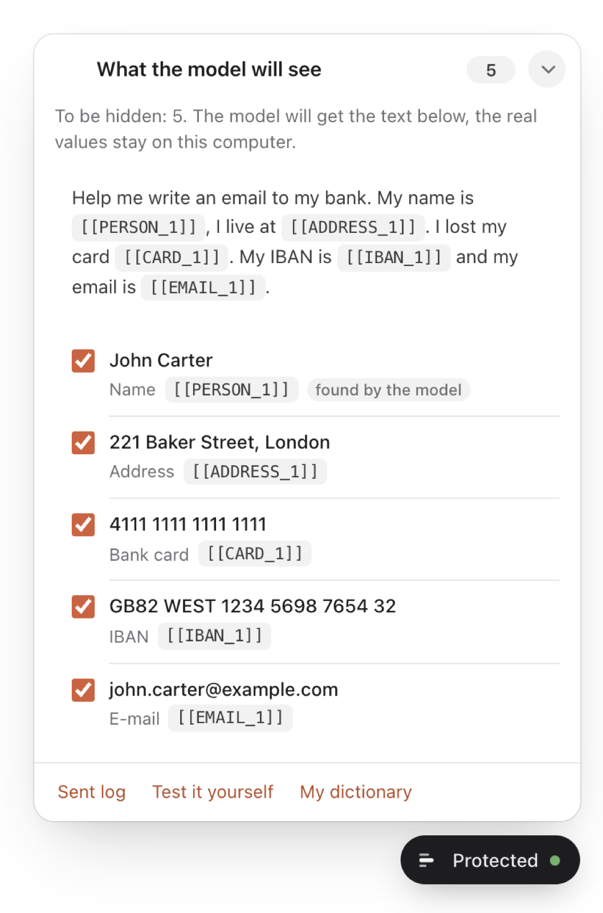
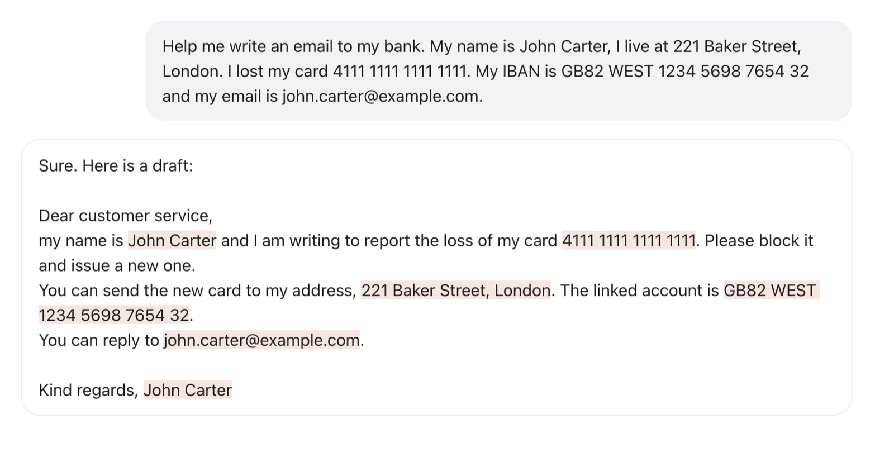
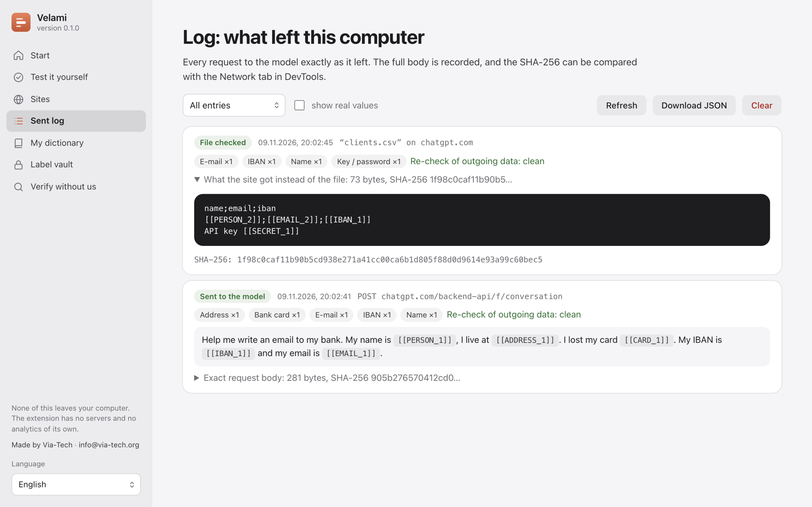

<p align="center">
  
</p>

<h1 align="center">Velami</h1>

<p align="center">
  Your personal data never reaches the AI.<br>
  A Chrome extension that hides names, cards, IBANs and keys before a message leaves the browser,
  and puts the real values back into the answer.
</p>

<p align="center"><a href="https://velami.pro"><strong>velami.pro</strong></a></p>

<p align="center">
  <a href="https://github.com/viatech-labs/velami/actions/workflows/ci.yml"></a>
  <a href="LICENSE"></a>
  
  
</p>

<p align="center">
  
  &nbsp;&nbsp;
  
</p>

## How it works

You type as usual. Before ChatGPT, Claude, Gemini or Perplexity sends your message, Velami replaces
personal data with labels such as `[[EMAIL_1]]` or `[[CARD_1]]`. The AI only ever sees the labels.
When the answer arrives, Velami shows the real values again, on your screen only.

Everything runs on your computer. Velami has no servers, no account and no analytics. The name and
address recognition model is bundled in the extension and runs locally.

## What it finds

**By format and checksum, always:** bank cards (Luhn), IBAN (mod-97), Italian codice fiscale,
Russian SNILS, phone numbers, e-mail, IP addresses, API keys (OpenAI, Anthropic, GitHub, GitLab,
AWS, Slack, Google, JWT, PEM), passwords after `password:`.

**By context, next to a word that names the number:** Russian INN, Italian partita IVA, passports
and identity cards (RU, IT), health insurance numbers, date of birth, car plates.

**Names and addresses:** a local GLiNER model (English, Italian, Russian) plus rules for full
Russian names and street addresses. See [docs/MODEL.md](docs/MODEL.md) for accuracy figures.

**Your dictionary:** clients, projects, internal codes. Checked before the model, with Russian
case endings.

**Files:** text files are cleaned in place. Word, Excel and PowerPoint are read locally in full,
including metadata, comments and their authors, tracked changes, fields, links, charts and embedded
workbooks, and go out as the same document with labels instead of the data. PDF up to 30 pages, scanned
pages included, goes out as a PDF with the same pages, the data covered by labels and a text layer
with labels, longer PDF as a clean text copy. On images (PNG, JPEG, WebP, GIF, BMP), and on images inside Office
documents, Velami reads the text on the device (Tesseract, Italian, English, Russian), covers the
data with labels and removes location and camera data. Files Velami cannot read are held back until
you decide.

## You can check it yourself

You should not have to trust us. Velami shows what it does:

- **The panel** next to the input shows exactly what the model will receive.
- **The log** keeps the exact body of every request with its SHA-256, so you can compare it with
  the Network tab in DevTools.
- **Test it yourself** sends a sample through the same code to an echo server and checks every value.
- **A watchdog** raises an alert if the page sends personal data to another address, and the pill
  turns red if a message left without Velami seeing it.
- **Reproducible build:** the same sources always give the same zip, byte for byte, and
  `npm run verify` compares an installed copy with the sources file by file.

<p align="center">
  
</p>

## Install

From the Chrome Web Store:
[Velami](https://chromewebstore.google.com/detail/bgbollfnmoffpolhpggejbjdkmelcpcn).

From a release: download `velami-<version>.zip` from
[Releases](https://github.com/viatech-labs/velami/releases), unzip it, open `chrome://extensions`,
turn on Developer mode and choose "Load unpacked".

From source:

```sh
npm ci
npm run setup   # onnxruntime-web and pdf.js into vendor/
npm run model   # name and address model into models/ner/, needs Python, see docs/MODEL.md
```

Then load the folder in `chrome://extensions`. The welcome page opens: add a few words to the
dictionary and press "Test it yourself".

## Sites

ChatGPT, Claude, Gemini and Perplexity work out of the box. Copilot, DeepSeek, Mistral Le Chat
and Grok can be turned on in Settings → Sites, Chrome then asks for permission for that site only.
The list lives in [`src/sites.js`](src/sites.js) and the manifest is generated from it.

## For organizations

An administrator can manage Velami through Chrome policy (`chrome.storage.managed`) from Google
Admin, Group Policy or Intune, a macOS profile or a Linux JSON file. The policy can lock settings,
push a company dictionary, and forbid sending unchecked files or the original of a file with
personal data. No extra permissions. Guide with examples: [docs/ENTERPRISE.md](docs/ENTERPRISE.md).

## Threat model

Velami protects you from your personal data ending up on the AI provider's servers: in logs, chat
history, training data, analytics. It does not protect you from page code that deliberately works
around the extension. A site's script can read the input field and send it encrypted, and no
browser extension can stop that. The welcome page says so.

## Architecture

| File | Runs in | Does |
|---|---|---|
| `src/detector.js` | background, extension pages, Node | detection, labels, restore, watchdog |
| `src/page-hook.js` | the chat page (MAIN world) | intercepts `fetch`, XHR, `sendBeacon`, WebSocket |
| `src/content.js` | isolated world | bridge, panel, restoring answers, files, clipboard |
| `src/background.js` | service worker | label vault, log, stats, model queue, policy |
| `src/offscreen.js` | offscreen document | onnxruntime-web model, PDF and Office text, OCR, covering |
| `src/ner-core.js` | offscreen document, Node | tokenizer and model input and output |
| `src/office.js` | offscreen document, Node | Word, Excel, PowerPoint text, zip reader with limits |
| `src/image.js` | offscreen document, Node | OCR layout, boxes for found values, metadata removal |
| `src/pdf.js` | offscreen document, Node | PDF text geometry, text layer with labels, PDF writer |
| `src/policy.js` | service worker, Node | organization policy from `chrome.storage.managed` |
| `src/sites.js`, `src/proto.js` | everywhere | supported sites, Gemini protobuf |
| `scripts/` | Node | reproducible zip and verification |
| `tools/model/` | Python | reproducible model build, hashes in `model.lock.json` |

The bridge from the page to the extension can only mask, check and log. It cannot reveal a label:
for "copy" and "was this file checked" the isolated world answers only yes or no.

## Development

```sh
npm test             # unit tests: detector, JSON walk, i18n, tokenizer, Office, policy, package
npm run e2e          # Chrome with the extension on a local copy of chatgpt.com, with the model
npm run e2e:files    # PDF, Word, Excel, PowerPoint, scans and images
npm run e2e:sites    # Gemini, Perplexity, Copilot, DeepSeek, Mistral, Grok, WebSocket
npm run e2e:policy   # organization policy
npm run eval:model   # model precision and recall on test/model-set.json
npm run build        # dist/velami-<version>.zip with SHA-256 of the zip and every file
npm run verify -- <folder or zip> [--list dist/velami-<version>.files.json]
```

All tests use made-up data only. The interface is in English, Italian and Russian
(`src/i18n.js`, store texts in `_locales/`).

## Limitations

The clean PDF copy is made of page images with a text layer, so links, forms, attachments and
vector quality are not kept, and PDF over 30 pages goes out as a text copy. Text on images is recognized automatically and can be
misread, faces, signatures and handwriting are not recognized. HEIC, TIFF, SVG and AVIF images and
old `.doc` and `.xls` are not parsed. The model misses some names and addresses and
sometimes flags too much. While loaded it uses about 250 MB of memory, and the package is about
198 MB. Interception follows each site's current API and will break if a site changes it, the
coverage check will tell you.

## Security

Please report vulnerabilities privately, see [SECURITY.md](SECURITY.md).

## License

Velami is free software under the [GNU Affero General Public License v3.0](LICENSE). If you build
it into a product or service, the AGPL requires you to publish your changes under the same license.
For a commercial license without these terms write to info@via-tech.org.

Made by [Via-Tech](https://via-tech.org). Privacy policy: [PRIVACY.md](PRIVACY.md).
